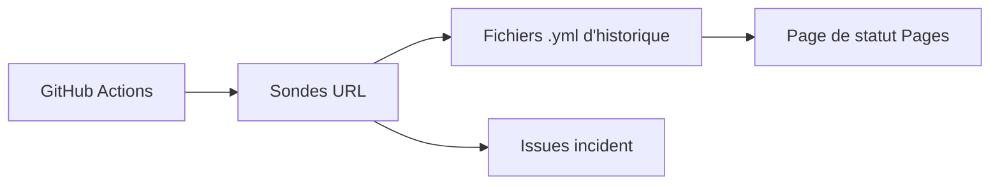

# HDVinnie/TrackerHub

> Moniteur de disponibilité et page de statut, via Upptime, pour une liste de trackers BitTorrent privés.

## Le problème
Savoir si des sites de partage privés sont en ligne, sans surveiller chacun à la main.

## Ce que ça fait vraiment
Dépôt Upptime : GitHub Actions sonde les URL, les issues servent de rapports d'incident, GitHub Pages sert la page de statut. Le README affiche un tableau (Up/Down, temps de réponse, disponibilité) pour une vingtaine de trackers, ses chiffres sont mis à jour automatiquement.

## Comment c'est branché

## Essayer
Aucune commande documentée.

## Coût et pièges
Gratuit via GitHub. Les trackers surveillés sont des sites privés de torrents ; les données du tableau sont celles du jour.

## Ce que ce n'est pas
Pas un outil à réutiliser tel quel : c'est une instance Upptime, pas un produit.

## Alternatives
Upptime (cité comme moteur ; fournit « votre propre moniteur »).

## Pour toi
À ignorer : surveille des sites de torrents ; si tu veux une page de statut, pars d'Upptime directement.

