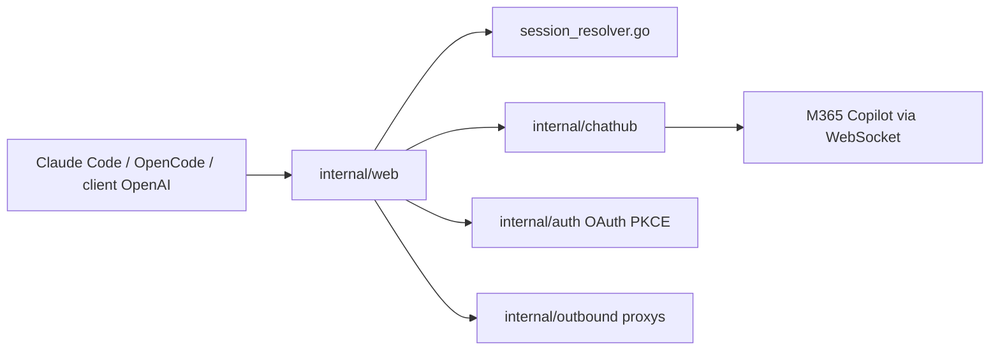

# HEXUXIU/M365-Copilot2API

> Go gateway that exposes M365 Copilot as an OpenAI- and Anthropic-compatible API, to plug in Claude Code or Cursor.

## The problem
A Microsoft 365 Copilot subscription offers no standard API: it cannot be used from Claude Code, OpenCode, Cursor or an OpenAI client.

## What it actually does
Translates the private ChatHub protocol (WebSocket) to `/v1/chat/completions`, `/v1/responses`, `/v1/messages` and `/v1/images/generations`. Handles OAuth/PKCE, multiple accounts with rotation and resumption, API keys, a proxy pool, usage statistics, multimodal inputs, tool calls and reuse of cloud conversations by content key. Web administration console included.

## How it is wired


## Trying it
```bash
chmod +x m365-copilot2api-linux-amd64 && ./m365-copilot2api-linux-amd64
# or from source:
export M365_ADMIN_PASSWORD=your_strong_password
go build -o m365-copilot2api ./cmd/server
go test ./...
```

## Cost and gotchas
Requires an M365 Copilot subscription and Microsoft accounts. The README itself warns that these uses may violate the terms of service and that bans are at your own risk. Default admin password `admin123` (change forced at first login). No official Dockerfile.

## What it is not
Not a Microsoft product. It is limited to personal use: the license is AGPL-3.0 with a restriction against reselling the API. The author provides no support for third-party agent frameworks.

## Alternatives
No alternative named in the README.

## For you
Ignore: it relies on a private protocol, risks breaking or getting banned, and its non-standard license forbids production use.
