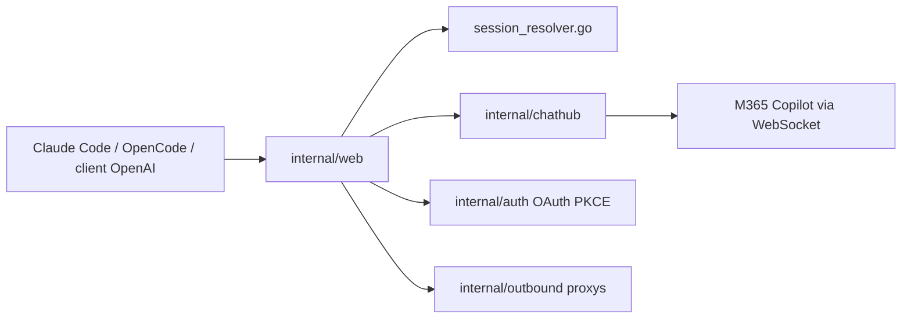

# HEXUXIU/M365-Copilot2API

> Passerelle Go qui expose M365 Copilot en API compatible OpenAI et Anthropic, pour brancher Claude Code ou Cursor.

## Le problème
Un abonnement Microsoft 365 Copilot n'offre pas d'API standard : impossible de l'utiliser depuis Claude Code, OpenCode, Cursor ou un client OpenAI.

## Ce que ça fait vraiment
Traduit le protocole privé ChatHub (WebSocket) vers `/v1/chat/completions`, `/v1/responses`, `/v1/messages` et `/v1/images/generations`. Gère OAuth/PKCE, plusieurs comptes avec rotation et reprise, clés d'API, pool de proxys, statistiques d'usage, entrées multimodales, appels d'outils et réutilisation des conversations cloud par clé de contenu. Console web d'administration incluse.

## Comment c'est branché


## Essayer
```bash
chmod +x m365-copilot2api-linux-amd64 && ./m365-copilot2api-linux-amd64
# ou depuis les sources :
export M365_ADMIN_PASSWORD=your_strong_password
go build -o m365-copilot2api ./cmd/server
go test ./...
```

## Coût et pièges
Demande un abonnement M365 Copilot et des comptes Microsoft. Le README avertit lui-même que ces usages peuvent violer les conditions de service et que les bannissements sont à tes risques. Mot de passe admin par défaut `admin123` (changement forcé à la première connexion). Pas de Dockerfile officiel.

## Ce que ce n'est pas
Ce n'est pas un produit Microsoft. Il est limité à un usage personnel : la licence est AGPL-3.0 avec une restriction contre la revente d'API. L'auteur ne fournit aucun support pour les frameworks d'agents tiers.

## Alternatives
Aucune alternative nommée dans le README.

## Pour toi
À ignorer : il repose sur un protocole privé, risque la rupture ou le bannissement, et sa licence non standard interdit l'usage en production.

