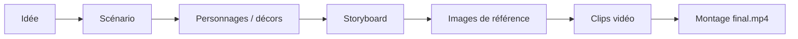

# HITsz-TMG/FilmAgent

> Web application that turns an idea into a complete video, from script to editing, using hosted models.

## The problem
Producing a narrative video requires chaining script, characters, shots, images and video, each step in a different tool, with no intermediate control.

## What it actually does
The README presents VideoClaw (the repository's content has changed): a step-by-step pipeline with editable assets — script, characters and sets, storyboard, reference images, video clips, editing. Three video generation modes (first frame, first and last frames, reference images). Usable through a web interface, from WeChat or Feishu, or as an OpenClaw skill. Lightweight pipelines: illustration video, motion transfer, digital presenter. The diagram describes the old FilmAgent (agents and Unity), which does not match the current README.

## How it is wired


## Trying it
```bash
git clone https://github.com/HITsz-TMG/VideoClaw.git
cd VideoClaw/video-claw/video-claw
chmod +x install.sh && ./install.sh
cd backend && uv run python api_server.py
cd ../frontend && npm start
```

## Cost and gotchas
Keys at your expense for LLM, image and video (OpenAI, Gemini, DeepSeek, DashScope, ARK, Kling depending on the chosen models). Video generation is billed per clip. Plan for ffmpeg, Python 3.9+, Node 18+.

## What it is not
Not a video generation model: it orchestrates third-party services. The repository name (FilmAgent) no longer matches the README's content (VideoClaw).

## Alternatives
No alternative named in the README (it cites Pixelle-Video, huobao-drama, Flova as inspirations).

## For you
Worth watching: a concrete example of multi-model orchestration with editable steps, but the cost per generation and the FilmAgent/VideoClaw confusion call for testing before adopting.
