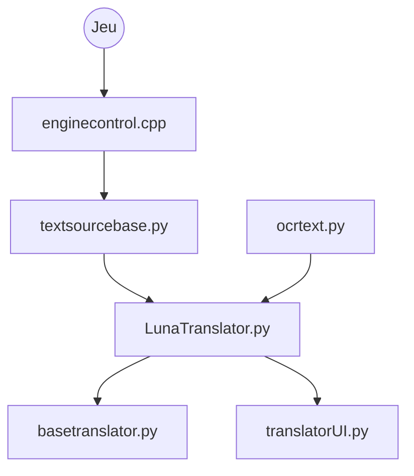

# HIllya51/LunaTranslator

> Visual novel translator for Windows, extracting the game's text through HOOK or OCR.

## The problem
Reading a Japanese game without a translation forces you to copy the text by hand into a translator.

## What it actually does
Extracts a game's text through native hooks, emulators (NS, PSP, PSV, PS2) or OCR, optimizes it, translates it through many engines (including language models and offline ones), displays it as an overlay and can embed it in the game. It also offers speech synthesis, Windows speech recognition, Japanese segmentation, AnkiConnect and Yomitan.

## How it is wired

## Trying it
No documented command. The README points to an external download page and manual.

## Cost and gotchas
Free. Some online translation, OCR or voice engines may require their own keys and bills, according to the diagram. Windows only according to the architecture description. README in Chinese.

## What it is not
Not a general-purpose document translation tool. Not cross-platform.

## Alternatives
- No alternative named in the README.

## For you
Ignore: niche use case (games), Windows only, no relevance for a data or MLOps pipeline.
