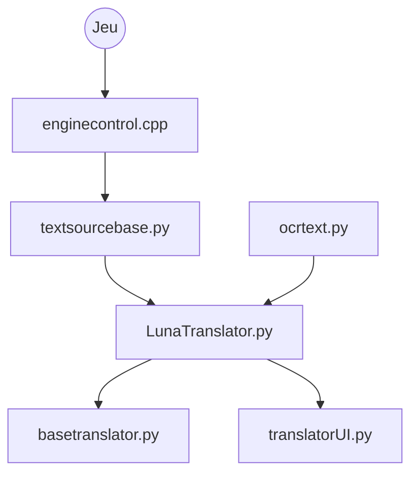

# HIllya51/LunaTranslator

> Traducteur de romans visuels pour Windows, extrayant le texte du jeu par HOOK ou OCR.

## Le problème
Lire un jeu japonais sans traduction oblige à copier le texte à la main dans un traducteur.

## Ce que ça fait vraiment
Extrait le texte d'un jeu par hooks natifs, émulateurs (NS, PSP, PSV, PS2) ou OCR, l'optimise, le traduit via de nombreux moteurs (dont des modèles de langage et du hors ligne), l'affiche en surcouche et peut l'intégrer dans le jeu. Il offre aussi la synthèse vocale, la reconnaissance vocale Windows, la segmentation du japonais, AnkiConnect et Yomitan.

## Comment c'est branché

## Essayer
Aucune commande documentée. Le README renvoie à une page de téléchargement et à un manuel externes.

## Coût et pièges
Gratuit. Certains moteurs de traduction, d'OCR ou de voix en ligne peuvent exiger leurs propres clés et factures, selon le diagramme. Windows seulement d'après la description d'architecture. README en chinois.

## Ce que ce n'est pas
Pas un outil généraliste de traduction de documents. Pas multiplateforme.

## Alternatives
- Aucune alternative nommée dans le README.

## Pour toi
À ignorer : cas d'usage de niche (jeux), Windows seulement, sans portée pour un pipeline data ou MLOps.

