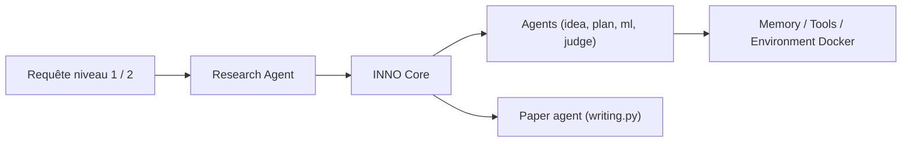

# HKUDS/AI-Researcher

> LLM agent system that chains literature review, implementation, experiments and paper writing.

## The problem
Going from an idea and a few reference papers to a tested, written-up prototype takes weeks.

## What it actually does
Two entry levels: a detailed idea, or only reference papers (the agent proposes the idea). A research agent (INNO module: idea, plan, survey, ml, judge, experiment analysis and draft agents) works in a Docker container with memories, a browser and tools (arXiv, GitHub). A writing agent produces the paper. A four-domain benchmark is provided, with a Gradio interface.

## How it is wired


## Trying it
```bash
uv venv --python 3.11
source ./.venv/bin/activate
uv pip install -e .
playwright install
docker pull tjbtech1/airesearcher:v1
python web_ai_researcher.py
```

## Cost and gotchas
LLM keys at your expense (OpenRouter, Anthropic, OpenAI…), GPU for the experiments, Docker. No licence declared. The README shows an example `sk-…` key in plain text: do not reuse it. Documentation is "coming soon".

## What it is not
Not a guarantee of valid scientific results: the README gives no figure for the reliability of generated papers. The marketing section titles ("full autonomy") are not backed by measurements in the README.

## Alternatives
No alternative named in the README.

## For you
Worth watching: interesting to see a complete research-agent chain, but unlicensed, costly in API calls and experimental.
