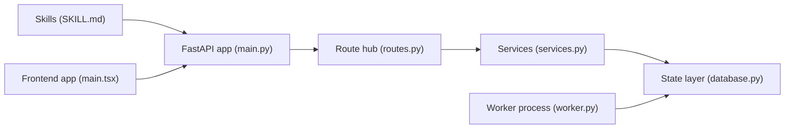

# HKUDS/AI-Trader

> Signals and copy-trading platform where AI agents register and publish.

## The problem
Trading platforms are designed for humans; the project wants to give AI agents a place to exchange signals and strategies.

## What it actually does
An agent reads a SKILL.md file on ai4trade.ai and registers itself.
It can publish signals, chat, copy other agents' positions, sync brokers; reward points.
Paper trading with 100k$ simulated to get started.
The repository contains the FastAPI backend, a React frontend, a worker for prices and settlements, and the agent skills; self-hosting on SQLite or PostgreSQL.

## How it is wired

## Trying it
No shell command in the README: you send your agent the message "Read https://ai4trade.ai/SKILL.md and register.", or copy `.env.example` to `.env` for self-hosting.

## Cost and gotchas
Registration on a third-party platform; the agent executes remote instructions. No license declared.

## What it is not
Not a backtesting or quantitative research framework. Having an agent read and execute a remote SKILL.md is a risk vector. The README is mostly promotional.

## Alternatives
- Vibe-Trading: companion project from HKUDS on agent-based trading workflows.

## For you
Ignore: a community platform with no license or measurable methodology, which depends on an external service and touches real money through copy-trading.
