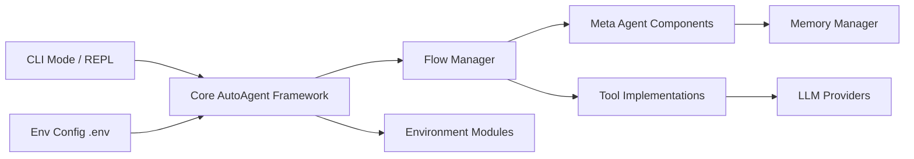

# HKUDS/AutoAgent

> Lab Python framework that creates LLM agents, tools and workflows from natural-language instructions.

## The problem
Assembling a multi-agent system requires hand-writing tools, profiles and orchestration. AutoAgent wants to replace that code with a dialogue.

## What it actually does
CLI (`auto main`, `auto deep-research`) with three modes: `user mode` (multi-agent research assistant), `agent editor` and `workflow editor`. The editors generate tool and agent code in a cloned mirror of the repository, run in a Docker container. Models go through LiteLLM (Claude 3.5 Sonnet by default). Scripts reproduce the GAIA and Agentic-RAG results from the paper.

## How it is wired


## Trying it
```bash
git clone https://github.com/HKUDS/AutoAgent.git
cd AutoAgent
pip install -e .
auto main
COMPLETION_MODEL=gpt-4o auto main
```

## Cost and gotchas
Docker is mandatory (the image is pulled automatically), a `GITHUB_AI_TOKEN` is required and an LLM provider key is at your expense. Detailed documentation is announced as "coming soon".

## What it is not
Not a stable framework to integrate: it is the code of a paper (arXiv 2502.05957). The "zero code" generates code that you must review, and workflow mode does not yet create tools.

## Alternatives
No alternative named in the README (only the sister project Auto-Deep-Research is cited).

## For you
Worth watching as a demonstrator of agent generation, not to adopt: missing documentation, last push October 2025 and a dependency on Docker plus several keys make real use costly.
