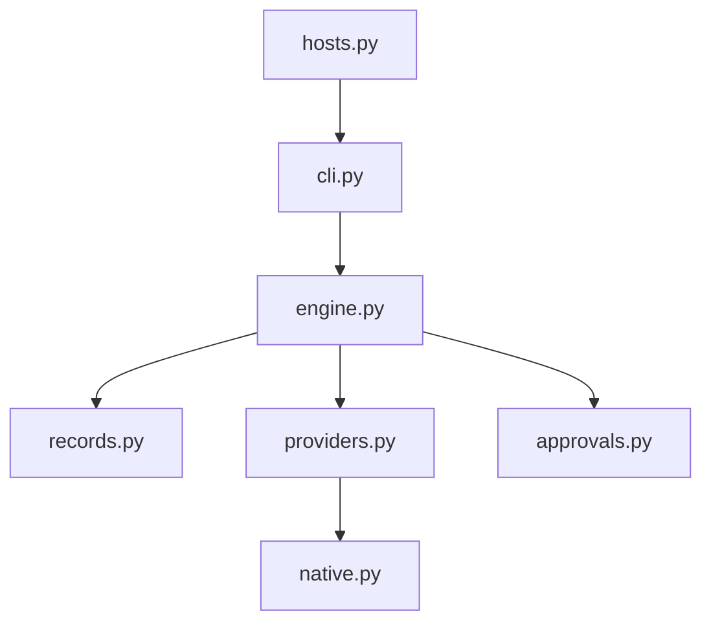

# HKUDS/AutoSwarm

> Coordinates several installed coding agents (Codex, Claude Code, Cursor...) to handle a task in parallel.

## The problem
Each agent has its own tools, context and interface; combining their results is done by hand.

## What it actually does
A plug-in/skill that any host agent calls: it chooses the suitable agents, shares context, launches parallel calls, handles approvals and messages, then verifies and synthesizes. The current runtime (`src/autoswarm`) keeps durable records; the former OPC application is archived in the tree.

## How it is wired


## Trying it
```bash
git clone https://github.com/HKUDS/AutoSwarm.git
cd AutoSwarm
uv tool install --force .
autoswarm setup --host codex
autoswarm doctor --agent codex --probe --cwd /path/to/project
```

## Cost and gotchas
Each agent called consumes its own subscription or tokens; `doctor --probe` spends model calls. No automatic update.

## What it is not
Not a new agent: a coordinator of existing agents. No quality measurement provided in the README.

## Alternatives
No alternative named.

## For you
Worth watching: useful concept for orchestrating several harnesses, but young and costly in tokens.
