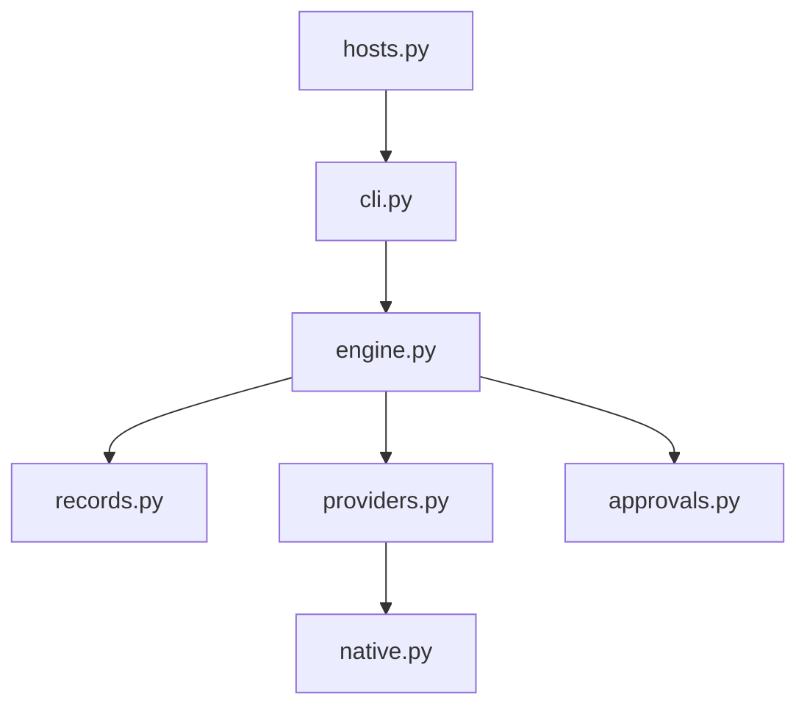

# HKUDS/AutoSwarm

> Coordonne plusieurs agents de code installés (Codex, Claude Code, Cursor…) pour traiter une tâche en parallèle.

## Le problème
Chaque agent a ses outils, son contexte et son interface ; combiner leurs résultats se fait à la main.

## Ce que ça fait vraiment
Un plug-in/skill que n'importe quel agent hôte appelle : il choisit les agents adaptés, partage le contexte, lance des appels en parallèle, gère approbations et messages, puis vérifie et synthétise. Le runtime actuel (`src/autoswarm`) garde des enregistrements durables ; l'ancienne application OPC est archivée dans l'arbre.

## Comment c'est branché


## Essayer
```bash
git clone https://github.com/HKUDS/AutoSwarm.git
cd AutoSwarm
uv tool install --force .
autoswarm setup --host codex
autoswarm doctor --agent codex --probe --cwd /path/to/project
```

## Coût et pièges
Chaque agent appelé consomme son propre abonnement ou ses jetons ; `doctor --probe` dépense des appels de modèle. Pas de mise à jour automatique.

## Ce que ce n'est pas
Pas un nouvel agent : un coordinateur d'agents existants. Aucune mesure de qualité fournie dans le README.

## Alternatives
Aucune alternative nommée.

## Pour toi
Surveiller : concept utile pour orchestrer plusieurs harnais, mais jeune et coûteux en jetons.

