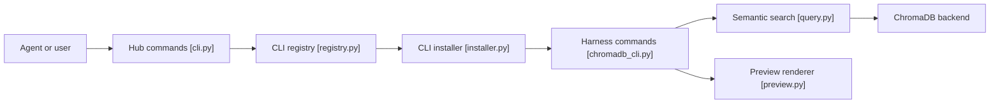

# HKUDS/CLI-Anything

> Generator and catalog of CLIs that make existing software drivable by AI agents.

## The problem
Agents reason well but drive professional software poorly: fragile UI automation or limited APIs.

## What it actually does
Two parts. CLI-Hub (`cli-hub`): a registry to list, install and launch community CLIs. Generator: an agent plugin or skill (Claude Code, Codex, Cursor, OpenClaw, etc.) that follows seven phases (analysis, design, implementation, test plans, tests, docs, publication) to produce a Click CLI with a REPL, `--json` output and a `SKILL.md` file. Each CLI calls the real software.

## How it is wired


## Trying it
```bash
pip install cli-anything-hub
cli-hub list
cli-hub search image
cli-hub install gimp
cli-hub launch gimp
npx skills add HKUDS/CLI-Anything --skill cli-hub-meta-skill -g -y
/plugin marketplace add HKUDS/CLI-Anything
/plugin install cli-anything
/cli-anything ./gimp
```

## Cost and gotchas
Python 3.10+, a coding agent and the target software installed. Announced limits: frontier models required, source available, iterative refinements. The agent's tokens are at your expense. `-g -y` installs globally without confirmation.

## What it is not
Not a guarantee of coverage: a generated CLI may be partial. The README's test figures are inconsistent (2,280+, 2,461, 2,464; "18 applications" versus more than forty listed).

## Alternatives
No alternative named in the README.

## For you
Worth watching: strong idea for equipping agents, but young (March 2026), several platforms marked experimental and results depend on the model.
