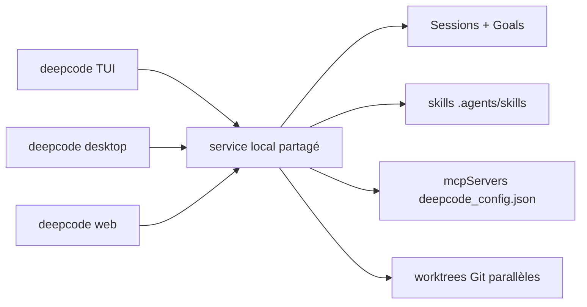

# HKUDS/DeepCode

> Local coding agent with three interfaces, born from a paper-reproduction project.

## The problem
An agent that generates code often stops at the suggestion: it does not re-read the
project, does not check the result and loses everything at the first interruption.

## What it actually does
A shared local service serves three clients — `deepcode` TUI, `deepcode desktop`,
`deepcode web` — which share projects, sessions, models, skills, permissions,
goals and automations. A durable "Goal" runs the agent over several
turns: you can add information, revise the goal, queue, stop,
resume after a restart. Verification by tests, builds, diagnostics, diffs and
artifacts, not by a plausible answer. Skills in `.agents/skills` and
`~/.agents/skills`, reading Claude directories without migration. Three permission
modes (Ask, Read only, Full access) and parallel agents isolated in Git
worktrees. Paper2Code remains the dedicated flow for research reproduction.

## How it is wired


## Trying it
```bash
uv tool install --python 3.12 deepcode-hku
deepcode init
deepcode provider set my-openrouter --template openrouter --api-key
deepcode provider test my-openrouter --model MODEL_ID
deepcode --trust --connection my-openrouter --model MODEL_ID
```

## Cost and gotchas
No DeepCode account, but the provider's API key is at your expense and a
Goal loop consumes a lot of tokens. Python 3.12+, Node 22+ for installation
from source, plus Rust for the source Desktop. Closing a client leaves
accepted tasks running: the machine must stay awake.

## What it is not
Not a hosted service: everything is local, sessions included. "Full access" mode
explicitly removes approvals and the filesystem sandbox — this is not
a detail. The README is truncated before the end. No license declared.

## Alternatives
- No alternative repository named in the README.

## For you
Direct competitor to what you already use; the Paper2Code angle is the only
differentiator to test. Keep watching.
