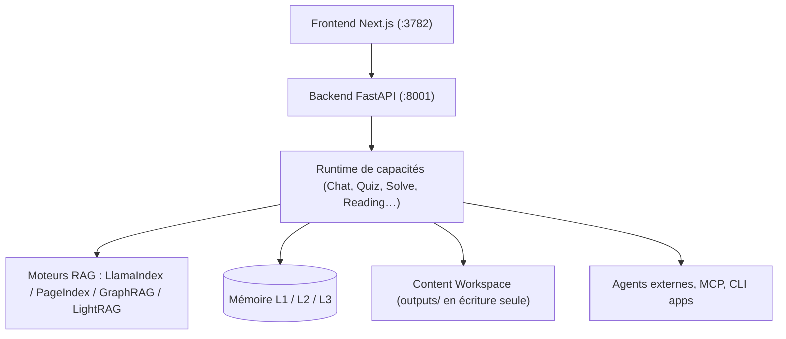

# HKUDS/DeepTutor

> Agent-based learning workspace: tutoring, quizzes, research, reading, and visualization.

## The problem
Learning from one's own documents involves using a PDF reader, a cat, a quiz tool, and notes, without a shared memory or tracked progress.

## What it actually does
Includes: Chat, Ask Questions, Quiz, Research, Visualize, Solve, Course Study, Mastery Path,
Immersive Reading and Immersive Watching on a single set of capabilities and a shared context.
Includes: knowledge bases, books, Co-Writer drafts, notebooks, question banks,
personas and memory, which can be reused across workflows according to user account permissions.
Accepts a YouTube URL for native reading with synchronized subtitles and tutoring anchored to timestamps. Allows you to access an external agent (Claude Code, Codex, Antigravity, Kimi, opencode…) or a partner in real-time. On the RAG side, it versions libraries on LlamaIndex, PageIndex, GraphRAG, LightRAG, WeKnora, an IMA or MarginNote 4 library, or an Obsidian vault linked.
Memory is inspectable across three layers: L1 traces, L2 summaries, and L3 synthesis.

## How it is wired


## Trying it
```bash
mkdir -p my-deeptutor && cd my-deeptutor
pip install -U deeptutor
deeptutor init
deeptutor start
docker run --rm --name deeptutor -p 127.0.0.1:3782:3782 -v deeptutor-data:/app/data ghcr.io/hkuds/deeptutor:latest
```

## Cost and gotchas
The software is free, but the models are not: `deeptutor init` requires a provider, base URL, key, and model. Python 3.11–3.14 **and** Node.js 20+ must be in the PATH, even for PyPI installation. The release pace is very fast (several versions per week), with a front/back refactor announced as breaking in version 1.6.3.

## What it is not
This is not a hosted service: everything runs on your own system, with a volume of data to be backed up.
The operation is read-only outside the `outputs/` directory, and the local sandbox is only a "best effort" fallback. This is not a stable project: the history shows it as constantly evolving.

## Alternatives
- **LightRAG**: The RAG engine from the same lab, integrated here as a premium option.
- **Open Notebook:** Integrated as a knowledge source through a dedicated skill.

## For you
Focus on its concepts – three-layer memory, multi-engine RAG – rather than simply adopting it.
