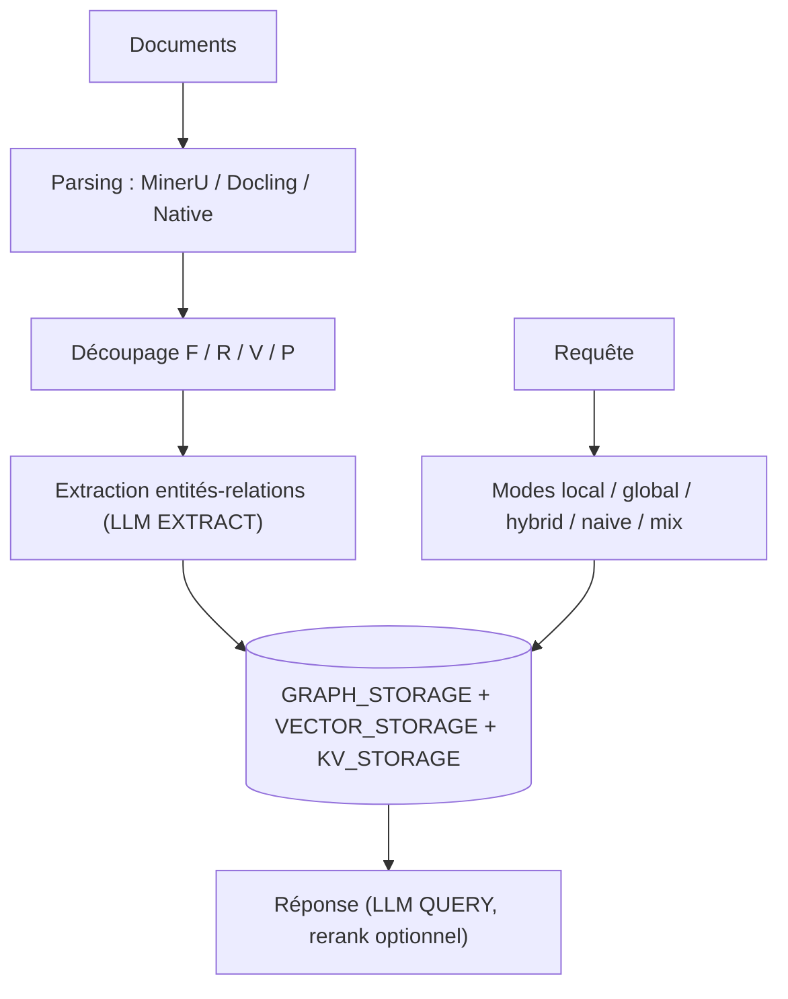

# HKUDS/LightRAG

> Knowledge-graph RAG, a lightweight alternative to GraphRAG, with a server and web interface.

## The problem
Chunk-based RAG loses context across documents, and GraphRAG restores it at the price of many LLM calls, long response times and costly updates.

## What it actually does
Maintains a two-layer architecture — knowledge graph and vectors — and a two-level retrieval that blends precise facts and abstract concepts.
Avoids community reports and multi-hop reasoning, which reduces the number of LLM calls at both indexing and query time. Handles incremental updates and selective deletion: when a document is deleted, the indexing LLM cache is used to quickly rebuild the affected entities and relations.
Offers five query modes (`local`, `global`, `hybrid`, `naive`, `mix`, with `mix` as the default), four chunking strategies including a semantic per-paragraph one aligned with headings and tables, and several parsing engines (MinerU, Docling, Native). Since v1.5, multimodal content (images, formulas, tables) is linked to the text through the graph.

## How it is wired


## Trying it
```bash
uv tool install "lightrag-hku[api]"
cp env.example .env
lightrag-server
git clone https://github.com/HKUDS/LightRAG.git && cd LightRAG
docker compose up
make env-base
```

## Cost and gotchas
Four model roles to configure (EXTRACT, QUERY, KEYWORD, VLM), hence four lines on the bill; the README insists that EXTRACT and KEYWORD be **non**-thinking models. Default storages are in-memory and explicitly unsuitable for production: PostgreSQL is recommended.
Security warning in the README itself: the server listens on `0.0.0.0` and, with no authentication configured, all endpoints are public. The embedding model can no longer be changed after indexing.

## What it is not
It is not plug-and-play: the default configuration "does not let the system give its best". It is not a service: it is a library plus a server you have to operate. It is not LLM-agnostic: it requires models capable of reliable entity extraction.

## Alternatives
- **Microsoft GraphRAG**: the reference that LightRAG positions itself against as a cheaper alternative.

## For you
The serious candidate if your RAG struggles with questions that span several documents.
