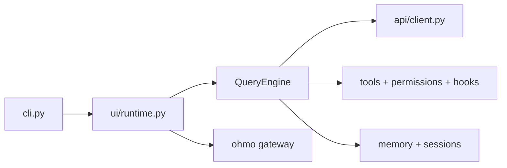

# HKUDS/OpenHarness

> Open source Python agent harness (loop, tools, memory, multi-agent) and its personal agent ohmo.

## The problem
Around an LLM you need a tool loop, permissions, memory and coordination; production implementations are closed.

## What it actually does
The `oh` command starts an agent loop: request, stream, tool call, permissions and hooks, result. More than 43 tools (files, shell, web, MCP, tasks), `SKILL.md` skills, Claude Code-compatible plugins, Anthropic/OpenAI-compatible providers, Copilot, Codex, Ollama. `ohmo` connects the agent to Feishu, Slack, Telegram, Discord. The `--dry-run` mode simulates without calling the model.

## How it is wired


## Trying it
```bash
pip install openharness-ai
oh setup
oh
oh --dry-run
ohmo init
```

## Cost and gotchas
API key from the provider, or an existing Claude/Codex subscription. The `Auto` mode allows everything: reserve it for sandboxes. Versions are 0.1.x, created in April 2026, last push in June 2026.

## What it is not
It is not a model. The README claims test results, but these are its own suites (114 tests), not an external evaluation.

## Alternatives
OpenClaw, nanobot and Cursor are cited as embeddable CLI agents; Claude Code is the reference whose formats it reuses.

## For you
Worth watching: a readable base for understanding and tinkering with an agent, but very young (0.1.x), so not yet a production foundation.
