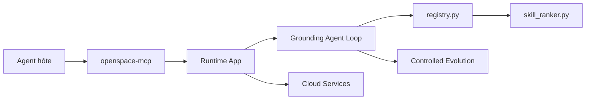

# HKUDS/OpenSpace

> Skill management layer for agents (MCP): find, evaluate and evolve SKILL.md files.

## The problem
With hundreds of skills, the agent can no longer find the right one, reuses those that fail and learns nothing from its failures.

## What it actually does
An MCP server (`openspace-mcp`), a CLI, a Python API and a dashboard share the same runtime.
Hybrid BM25 + embeddings ranking, SQLite storage of versions and quality metrics.
FIX / DERIVED / CAPTURED evolution with validation; provisional status, then trusted after successful use.
Optional cloud hub to share skills, with explicit local import.

## How it is wired


## Trying it
```bash
git clone https://github.com/HKUDS/OpenSpace.git && cd OpenSpace
pip install -e .
openspace-mcp --help
openspace --model "anthropic/claude-sonnet-4-5" --query "Create a monitoring dashboard for my Docker containers"
```

## Cost and gotchas
Requires Python 3.12+, an LLM key and Node 20 for the dashboard. The cloud sends quality and trace telemetry (with redaction).

## What it is not
Not a ready-to-use autonomous agent: it is a layer to plug in. The `autonomous` evolution mode is on by default and rewrites skills.

## Alternatives
No alternative named in the README.

## For you
Worth watching: the idea of scoring skills on evidence fits your Claude Code usage, but the project is six months old and its automatic evolution rewrites your skills by default.
