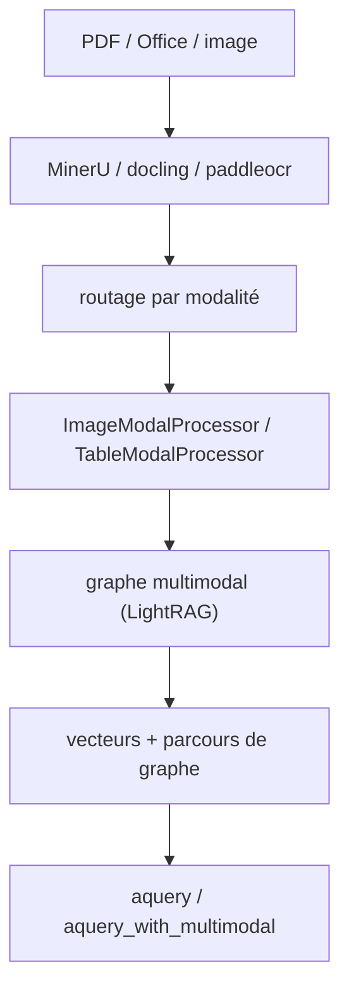

# HKUDS/RAG-Anything

> Multimodal RAG built on LightRAG, for querying PDFs mixing text, images, tables and formulas.

## The problem
A text-only RAG throws away everything that is not text: the figures, tables and equations
of a report or paper vanish from the index, and answers rely on half of the document.

## What it actually does
A five-stage pipeline: parsing (MinerU, docling or paddleocr; PDF, Office, images), routing
of content by modality, analysis by dedicated processors (`ImageModalProcessor`, `TableModalProcessor`,
LaTeX equations, extensible `GenericModalProcessor`), construction of a multimodal knowledge graph
with `belongs_to` relations, then hybrid retrieval of vectors + graph.
Three families of queries: `aquery` (hybrid/local/global/naive modes), automatic VLM queries,
and `aquery_with_multimodal` with content supplied by hand.

## How it is wired


## Trying it
```bash
pip install raganything
mineru --version
python -c "from raganything import RAGAnything; rag = RAGAnything(); print('✅ MinerU installed properly' if rag.check_parser_installation() else '❌ MinerU installation issue')"
uv sync --all-extras
```

## Cost and gotchas
Every image goes through a vision model (`gpt-4o` in the examples) and every document through an LLM:
ingestion costs money, not just querying. Office documents require LibreOffice to be installed.
The `[image]` and `[text]` extras are needed for BMP/TIFF/GIF/WebP and TXT/MD. MinerU models
are downloaded on first use. The README is truncated before the end of the "existing instance" section.

## What it is not
Not independent: it is a layer on top of LightRAG, from which it inherits storage and modes.
Not ready to use: you have to write `llm_model_func`, `vision_model_func` and `embedding_func` yourself.
The figures in the example table (95.2% versus 87.3%) are demonstration content, not a benchmark.

## Alternatives
- LightRAG: the base, if multimodal is not needed.
- docling / paddleocr: alternative parsers to MinerU, configurable through `parser=`.

## For you
The serious candidate if your corpora are technical PDFs; measure the ingestion cost on a single document first.
