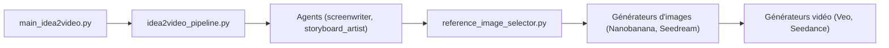

# HKUDS/ViMax

> Agent framework that produces a video from an idea, a script or a novel.

## The problem
Video generators only produce a few seconds, with inconsistent characters and no script.

## What it actually does
Pipelines (`idea2video`, `script2video`) chain agents: character and scene extraction, storyboard, reference image selection, image then video generation, assembly. Chat, image and video models are called through APIs configured in YAML. A TUI and a web interface exist.

## How it is wired


## Trying it
```bash
git clone https://github.com/HKUDS/ViMax.git
cd ViMax
uv sync
cp configs/agent.example.yaml configs/agent.local.yaml
vimax tui
cd web
npm install
npm run dev
```

## Cost and gotchas
Three API keys at your expense (LLM, image, video), so the bill depends on video length. The cost is not quantified in the README.

## What it is not
Not a generation model: it orchestrates external services. The README's "movie-grade" quality is not measured.

## Alternatives
No alternative named in the README.

## For you
Keep an eye on it: a good example of multi-agent orchestration, but costly and dependent on third-party providers.
