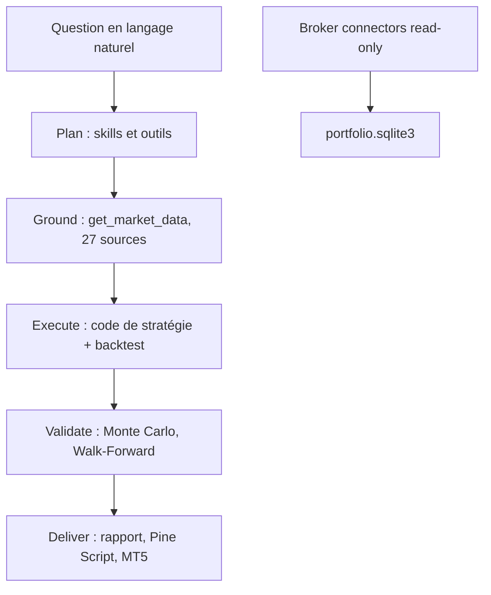

# HKUDS/Vibe-Trading

> Agent-driven financial research workspace: data, backtests, reports, broker connectors.

## The problem
Going from a market question to an executable analysis means stitching together data loaders, a backtest engine, metrics and a report.
Each data source has its own API, its own quotas and its own risk of IP blocking.

## What it actually does
Turns a natural-language question into an executable analysis: market research, strategy code generation, backtest, validation (Monte Carlo, Bootstrap, Walk-Forward), report and export.
One `get_market_data` call, 27 sources, with a per-market fallback chain ordered by IP-blocking risk: A-share, US, HK, India, Korea, UK, crypto, forex/metals; 22 read-only data tools exposed over MCP.
Shadow Account: reads a broker export, profiles the behavior (holding time, win rate, disposition effect, overtrading), extracts the implicit rules and replays them in a backtest.
462 prebuilt alphas (Qlib 158, Kakushadze 101, GTJA 191, academic, PIT-safe fundamentals), 30 agent-team presets, 18 broker connectors with a structural paper/live guard.

## How it is wired


## Trying it
```bash
pip install vibe-trading-ai
vibe-trading run -p "Backtest a BTC-USDT 20/50 moving-average strategy for 2024, summarize return and drawdown, then export the report"
vibe-trading alpha bench --zoo gtja191 --universe csi300 --period 2018-2025 --top 20
vibe-trading connector setup okx-live-sdk-readonly --connection-id main-okx --label "Main OKX"
```

## Cost and gotchas
The 23 built-in sources are free and keyless; QVeris is a premium credit-based marketplace, with a referral link openly included in the README.
Autonomous trading through a broker you authorize does exist: the README bounds it with a user mandate (allowlist, caps, kill switch) and structurally refuses live mode on brokers that have no paper/live discriminator.

## What it is not
It is not financial advice nor a turnkey trading bot: the positioning is research, simulation and backtesting.
It is not risk-free with real money: the live path exists, and broker keys must never go through an AI chat (the README repeats this).
It is not a mature project: many connectors are marked "Experimental", unverified per broker; the README provided is truncated in the middle of the backtest engines table.

## Alternatives
No alternative is named; the project cites Qlib as a source of alphas, not as a competitor.

## For you
Worth a look for its mechanisms (source fallback, paper/live guard, alpha zoo) more than for trading; never connect a real account.
