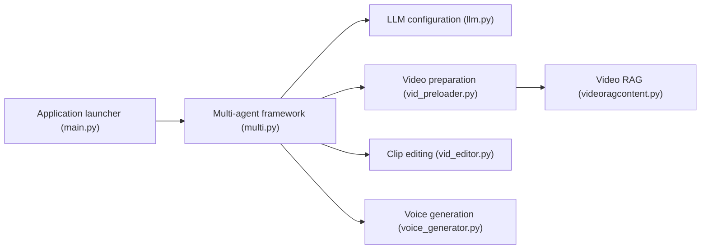

# HKUDS/VideoAgent

> Multi-agent framework to understand, edit and remix videos from natural-language instructions.

## The problem
Editing, summarizing or redoing a video means chaining transcription, retrieval, voice and editing by hand.

## What it actually does
Analyzes the intent, generates an agent workflow graph with a self-evaluation loop, then executes it: Q&A and summaries, editing and beat-synced cuts, commentary videos, remakes (memes, music clips, cross-cultural stand-up). Uses CosyVoice, fish-speech, seed-vc, DiffSinger, Whisper, ImageBind; VideoRAG for indexing. The evaluations in the README are internal.

## How it is wired


## Trying it
```bash
git clone https://github.com/HKUDS/VideoAgent.git
conda create --name videoagent python=3.10
conda activate videoagent
conda install -y -c conda-forge pynini==2.1.5 ffmpeg
pip install -r requirements.txt
python main.py
```

## Cost and gotchas
8 GB GPU, download of several checkpoints, Claude keys (mandatory for the router), DeepSeek, GPT and Gemini depending on the scenario. The demo content comes from the internet, rights not guaranteed.

## What it is not
Not a turnkey product: the README is very promotional, the results are self-reported and the details of the roles were not inspected.

## Alternatives
- Director, Funclip, NarratoAI, NotebookLM: compared in the README table, with fewer creative features.

## For you
Worth watching: interesting research on multimodal agents, but the heavy installation and four API keys make it a test bench, not a tool.
