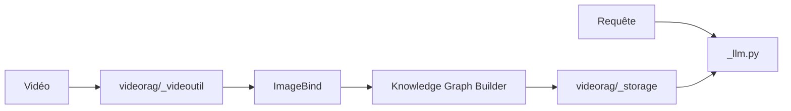

# HKUDS/VideoRAG

> RAG framework for very long videos, with the Vimo desktop application, for researchers.

## The problem
Querying dozens of hours of video exceeds the context of multimodal models.

## What it actually does
Videos are split, transcribed (ASR), captioned, encoded with ImageBind, then indexed in a multimodal knowledge graph and a vector database (Neo4j, hnswlib, nano-vectordb). At query time, adaptive retrieval feeds an LLM (OpenAI or Ollama). The authors report 134 hours on a single RTX 3090 and a LongerVideos benchmark (164 videos, 602 queries). The Vimo application (Electron) is announced as coming soon.

## How it is wired

## Trying it
No installation command is given in this README: it points to the `Vimo-desktop` and `VideoRAG-algorithm` folders (conda environment, checkpoints, dependencies). The application download is "coming soon".

## Cost and gotchas
A 24 GB GPU is recommended, models must be downloaded, LLM calls are at your expense if using OpenAI. The license is present but not recognized by GitHub. Last push in March 2026.

## What it is not
Not a ready-to-install application: the binary release does not exist yet. The performance figures (60.2% on Video-MME long) are the authors' own and the variance between runs is noted.

## Alternatives
No alternative is named in the README (only the MiniCPM models are cited as a comparison baseline).

## For you
Worth watching: the multimodal graph idea for long videos is interesting, but installation is not documented here, the license is unclear and the hardware is heavy.
