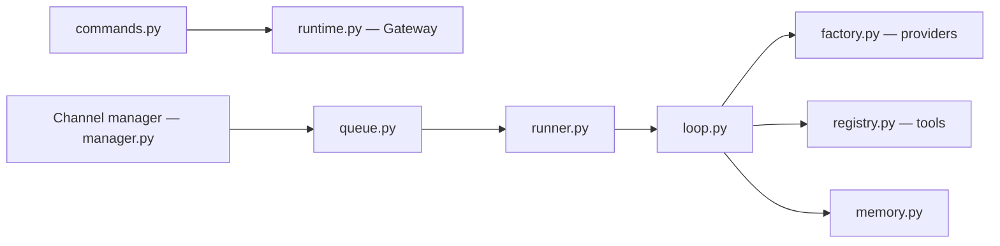

# HKUDS/nanobot

> Python framework for a self-hosted, personal AI agent, accessible via a web UI, terminal, or messaging applications.

## The problem
A personal assistant who needs to remember, use, and manage scheduled tasks often requires a complex and inflexible platform.

## What it actually does
LLM/tools loop (`agent/loop.py`) with file, shell, web, MCP, cron, and sub-agent tools.
Long-term memory and persistent sessions; scheduled automation and local triggers.
Channels: Telegram, Slack, Discord, WeChat, email…; Compatible with OpenAI API and Python SDK.
Providers with fallback options (Anthropic, OpenAI, Bedrock, local); Workspace access policy.

## How it is wired


## Trying it
```bash
uv tool install nanobot-ai
nanobot --version
nanobot webui
nanobot -m "Hello!"
```

## Cost and gotchas
LLM or local model provider key. Python ≥ 3.11. Render deployment: requires a paid persistent disk.

## What it is not
It's not just a template; access to the shell and files gives the agent real power, allowing them to control the system through the access mode.

## Alternatives
- OpenClaw: cited as a starting point for a "gateway-first" approach.

## For you
A good candidate for a self-hosted personal assistant; suitable for testing in a limited workspace.
