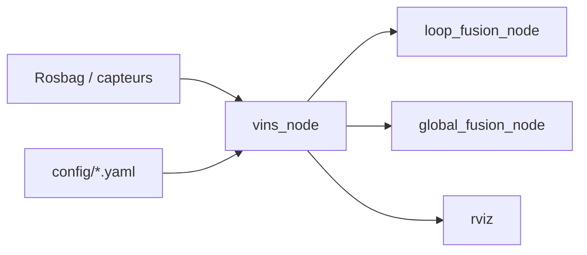

# HKUST-Aerial-Robotics/VINS-Fusion

> Optimization-based multi-sensor state estimator to localize drones, cars and AR/VR headsets, for roboticists.

## The problem
A robot must know its position from cameras and an inertial unit, precisely and without permanent GPS.

## What it actually does
It fuses monocular camera, stereo and IMU, with online spatial and temporal calibration and visual loop closure. One example also fuses a GPS. It runs as ROS nodes (vins_node, loop_fusion_node, global_fusion_node) on the EuRoC and KITTI datasets.

## How it is wired
Schéma simplifié d'après la fiche, sans diagramme fourni.


## Trying it
```bash
cd ~/catkin_ws/src
git clone https://github.com/HKUST-Aerial-Robotics/VINS-Fusion.git
cd ../
catkin_make
roslaunch vins vins_rviz.launch
rosrun vins vins_node ~/catkin_ws/src/VINS-Fusion/config/euroc/euroc_mono_imu_config.yaml
```

## Cost and gotchas
Free. It requires Ubuntu 16.04 or 18.04, ROS Kinetic or Melodic and Ceres Solver, all old versions. The last push dates from May 2024. Hardware (global shutter, synchronization) weighs on quality.

## What it is not
It is not a turnkey product: the README specifies that the paper is not exactly identical to the code. It depends heavily on hardware.

## Alternatives
VINS-Mono, of which it is the multi-sensor extension. The README names no other alternative.

## For you
Ignore: a robotics tool frozen on old Ubuntu and ROS versions, outside the data, AI or MLOps scope.
