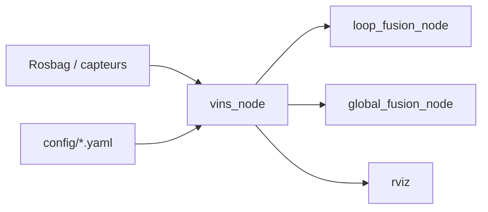

# HKUST-Aerial-Robotics/VINS-Fusion

> Estimateur d'état multi-capteurs par optimisation pour localiser drones, voitures et casques AR/VR, pour roboticiens.

## Le problème
Un robot doit connaître sa position à partir de caméras et d'une centrale inertielle, de façon précise et sans GPS permanent.

## Ce que ça fait vraiment
Il fusionne caméra mono, stéréo et IMU, avec calibration spatiale et temporelle en ligne et fermeture de boucle visuelle. Un exemple fusionne aussi un GPS. Il s'exécute comme nœuds ROS (vins_node, loop_fusion_node, global_fusion_node) sur des jeux de données EuRoC et KITTI.

## Comment c'est branché

Schéma simplifié d'après la fiche, sans diagramme fourni.

## Essayer
```bash
cd ~/catkin_ws/src
git clone https://github.com/HKUST-Aerial-Robotics/VINS-Fusion.git
cd ../
catkin_make
roslaunch vins vins_rviz.launch
rosrun vins vins_node ~/catkin_ws/src/VINS-Fusion/config/euroc/euroc_mono_imu_config.yaml
```

## Coût et pièges
Gratuit. Il faut Ubuntu 16.04 ou 18.04, ROS Kinetic ou Melodic et Ceres Solver, des versions anciennes. Le dernier push remonte à mai 2024. Le matériel (obturateur global, synchronisation) pèse sur la qualité.

## Ce que ce n'est pas
Ce n'est pas un produit clé en main : le README précise que le papier n'est pas exactement identique au code. Il dépend fortement du matériel.

## Alternatives
VINS-Mono, dont il est l'extension.

## Pour toi
À ignorer : outil de robotique figé sur des versions d'Ubuntu et ROS anciennes, hors du périmètre data, IA ou MLOps.

