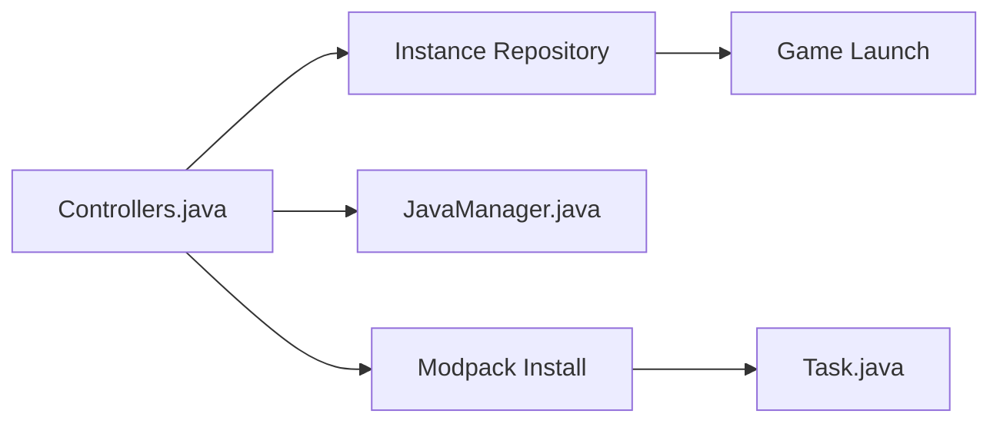

# HMCL-dev/HMCL

> Cross-platform Minecraft launcher with mod, modpack and mod loader management.

## The problem
Installing Forge, Fabric and modpacks for Minecraft by hand is tedious.

## What it actually does
Java application: game instances, installation of components and modloaders (Forge, NeoForge, Fabric, Quilt, OptiFine…), Java management, modpack creation, accounts, themes. Runs on several systems and architectures (x86, ARM, RISC-V, MIPS, LoongArch).

## How it is wired


## Trying it
```bash
# Téléchargement depuis le site officiel ou les releases ; aucune commande dans le README.
```

## Cost and gotchas
Free. Additional GPLv3 §7 clauses: a fork must change the name or version and keep the copyright notice.

## What it is not
Not affiliated with Mojang. Documentation mostly in Chinese and multilingual.

## Alternatives
No alternative named in the README.

## For you
Ignore: a gaming tool with no link to data, AI or MLOps.
