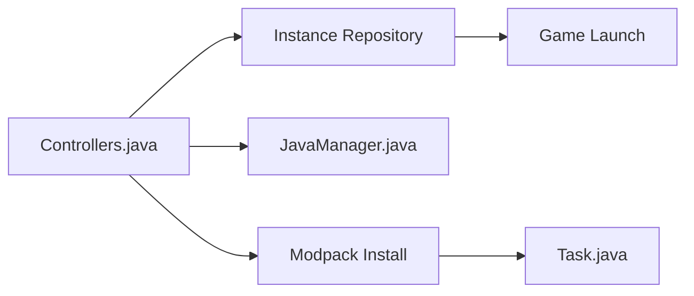

# HMCL-dev/HMCL

> Lanceur Minecraft multiplateforme avec gestion de mods, modpacks et chargeurs de mods.

## Le problème
Installer Forge, Fabric et des modpacks pour Minecraft à la main est laborieux.

## Ce que ça fait vraiment
Application Java : instances de jeu, installation de composants et de modloaders (Forge, NeoForge, Fabric, Quilt, OptiFine…), gestion de Java, création de modpacks, comptes, thèmes. Tourne sur plusieurs systèmes et architectures (x86, ARM, RISC-V, MIPS, LoongArch).

## Comment c'est branché


## Essayer
```bash
# Téléchargement depuis le site officiel ou les releases ; aucune commande dans le README.
```

## Coût et pièges
Gratuit. Clauses additionnelles GPLv3 §7 : un fork doit changer nom ou version et garder la mention de droits.

## Ce que ce n'est pas
Pas affilié à Mojang. Documentation surtout en chinois et multilingue.

## Alternatives
Aucune alternative nommée dans le README.

## Pour toi
À ignorer : outil de jeu sans lien avec la data, l'IA ou le MLOps.

