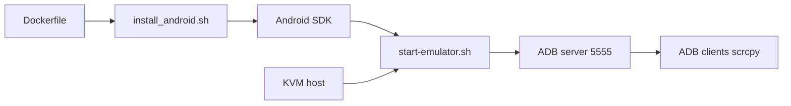

# HQarroum/docker-android

> Alpine Docker image that runs the Android emulator as a headless service, for CI and testing.

## The problem
Testing mobile applications in CI requires reproducible Android emulators that can be driven remotely.

## What it actually does
Minimal image with emulator, ADB, QEMU/libvirt and JRE 11, accelerated by KVM. API level, image type (Google APIs or Play Store) and architecture are configurable at build time. ADB exposed on port 5555, `scrcpy` compatible. GPU (CUDA) variants via `Dockerfile.gpu`. Disk is wiped on every restart except for the `/data` volume.

## How it is wired


## Trying it
```bash
docker build -t android-emulator .
docker run -it --rm --device /dev/kvm -p 5555:5555 android-emulator
adb connect 127.0.0.1:5555
```

## Cost and gotchas
Free. At least 4 GB of memory and 8 GB of disk (API 33); image up to 5.84 GB; host with `/dev/kvm`. Only x86 and x86_64 are supported.

## What it is not
No active ARM support. Not a managed mobile testing service.

## Alternatives
The README cites alpine-android and another docker-android (WebRTC interface).

## For you
Worth watching only if you test a mobile app; outside classic data/AI pipelines.
