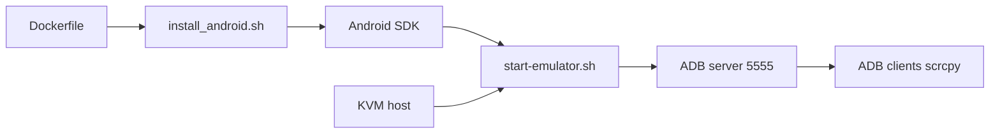

# HQarroum/docker-android

> Image Docker Alpine qui exécute l'émulateur Android en service headless, pour CI et tests.

## Le problème
Tester des applications mobiles en CI nécessite des émulateurs Android reproductibles et pilotables à distance.

## Ce que ça fait vraiment
Image minimale avec émulateur, ADB, QEMU/libvirt et JRE 11, accélérée par KVM. API, type d'image (Google APIs ou Play Store) et architecture réglables à la construction. ADB exposé sur le port 5555, `scrcpy` compatible. Variantes GPU (CUDA) via `Dockerfile.gpu`. Disque effacé à chaque redémarrage sauf volume `/data`.

## Comment c'est branché


## Essayer
```bash
docker build -t android-emulator .
docker run -it --rm --device /dev/kvm -p 5555:5555 android-emulator
adb connect 127.0.0.1:5555
```

## Coût et pièges
Gratuit. 4 Go de mémoire et 8 Go de disque minimum (API 33) ; image jusqu'à 5,84 Go ; hôte avec `/dev/kvm`. Seuls x86 et x86_64 sont supportés.

## Ce que ce n'est pas
Pas de support ARM actif. Pas un service de test mobile géré.

## Alternatives
Le README cite alpine-android et un autre docker-android (interface WebRTC).

## Pour toi
À surveiller seulement si tu testes une appli mobile ; hors pipelines data/IA classiques.

