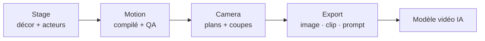

# HaD0Yun/CozyClay

> In-browser 3D preview studio that prepares a plan for an AI video model.

## The problem
An AI-generated video is paid for on every attempt, and a text prompt cannot pin down where each character stands, how they move and where the camera is.

## What it actually does
You build a 3D set, move the characters, place the camera and the cuts. A deterministic compiler bakes the motions, with quality control for collisions and foot sliding. The export provides first frame, gray clip, camera and prompt, plus mp4, depth passes and an OTIO cut list. An AI agent drives the scene through a panel, an MCP server or the terminal.

## How it is wired


## Trying it
```bash
npx cozyclay
npx -y cozyclay mcp
```
The studio opens at `http://127.0.0.1:5180/app/`.

## Cost and gotchas
Node.js 22.19 or later and a Chromium browser, no GPU. The agent requires a ChatGPT login or your own key (Anthropic, OpenAI, Gemini, etc.). Video generation is still billed by the chosen model.

## What it is not
It is not a video generator: it prepares the input for an external model. Anonymous telemetry exists, which can be disabled with `cclay telemetry off`.

## Alternatives
No alternative named in the README.

## For you
Worth watching: interesting if you are experimenting with generative video using MCP agents, but young (created in July 2026), under AGPL and centered on one person.
