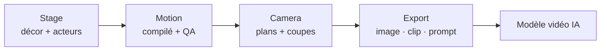

# HaD0Yun/CozyClay

> Studio de prévisualisation 3D dans le navigateur qui prépare un plan pour un modèle de vidéo IA.

## Le problème
Une vidéo générée par IA se paie à chaque essai, et un prompt texte ne peut pas fixer où chacun se tient, comment il bouge et où est la caméra.

## Ce que ça fait vraiment
Tu montes un décor en 3D, déplaces les personnages, poses la caméra et les coupes. Un compilateur déterministe cuit les mouvements, avec contrôle qualité des collisions et du glissement de pieds. L'export donne première image, clip gris, caméra et prompt, plus mp4, passes de profondeur et liste de coupes OTIO. Un agent IA pilote la scène par panneau, serveur MCP ou terminal.

## Comment c'est branché


## Essayer
```bash
npx cozyclay
npx -y cozyclay mcp
```
Le studio s'ouvre sur `http://127.0.0.1:5180/app/`.

## Coût et pièges
Node.js 22.19 ou plus et un navigateur Chromium, sans GPU. L'agent demande une connexion ChatGPT ou ta propre clé (Anthropic, OpenAI, Gemini, etc.). La génération vidéo reste facturée par le modèle choisi.

## Ce que ce n'est pas
Ce n'est pas un générateur de vidéo : il prépare l'entrée d'un modèle externe. La télémétrie anonyme existe, désactivable par `cclay telemetry off`.

## Alternatives
Aucune alternative nommée dans le README.

## Pour toi
À surveiller : intéressant si tu expérimentes la vidéo générative avec des agents MCP, mais jeune (créé en juillet 2026), sous AGPL et centré sur une personne.

