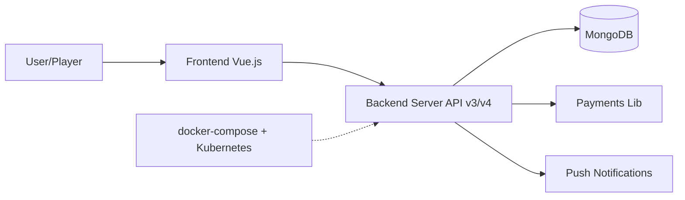

# HabitRPG/habitica

> Open-source web app that turns habits and tasks into a role-playing game, for people who want to stay motivated.

## The problem
Sticking to your habits and to-do list with no immediate reward is demotivating.

## What it actually does
Vue.js client and Node/Express server (API v3 and v4) on MongoDB. Completed tasks give levels and gold, failures cost hit points. Stripe, PayPal, Amazon, Apple and Google payments, push notifications. Mobile apps in separate repositories (Android, iOS).

## How it is wired

## Trying it
No install command in the README: it points to the GitHub wiki ("Setting up Habitica Locally"). The code mentions a `Dockerfile-Dev` and docker-compose files.

## Cost and gotchas
Free locally. Since August 4, 2026, code contributions are suspended and AI-generated code is forbidden. Bugs are reported by e-mail to the admin, not through an issue.

## What it is not
Not a project open to contributions at the moment. The license is "described" in a LICENSE file that GitHub does not identify: read it before any reuse.

## Alternatives
No alternative cited in the README.

## For you
Ignore for a data/AI/MLOps profile: it is a consumer app, unrelated to your work, and closed to contributions; useful only as a Vue/Node/Mongo architecture study.
