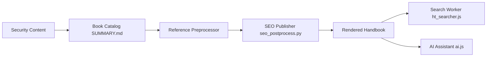

# HackTricks-wiki/hacktricks

> Multilingual cybersecurity knowledge base, to be read online, for security practitioners.

## The problem
Security techniques are scattered across articles, repositories and personal notes. A single indexed reference avoids looking them up one by one.

## What it actually does
The README read is limited to the mention "src/README.md": the material is insufficient. Based on the described architecture, the repository gathers guides by domain (web, binary exploitation, platform hardening, AI security), a SUMMARY.md catalog, a preprocessor and an SEO publisher. The rendered book offers search, syntax highlighting, navigation, an AI assistant, and sponsor and training modules.

## How it is wired

## Trying it
No command documented in the README read. The content is consulted online; the URL does not appear in it.

## Cost and gotchas
Free to read. The AI assistant and sponsors rely on third-party services. License not declared in the catalog: reuse of the content to be checked.

## What it is not
Not an executable tool nor a structured training course. Some deployment details were not examined. The techniques described apply legitimately only to authorized systems.

## Alternatives
No alternative named in the README.

## For you
To watch: useful reference for deployment security and AI security, but do not reuse the content until the license is clarified.
