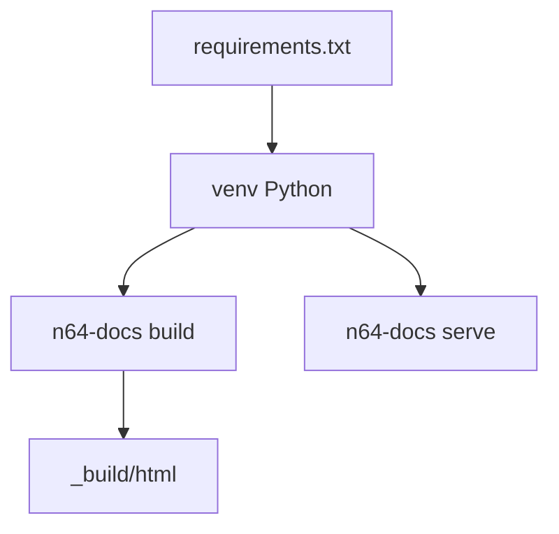

# HailToDodongo/pyrite64

> README of Pyrite64's Sphinx documentation, with no presentation of the tool itself.

## The problem
Not documented: the README only describes how to build the documentation, not the problem Pyrite64 solves.

## What it actually does
The supplied text explains how to generate the docs with Sphinx, from a shared `n64-docs` repository. The name evokes the Nintendo 64, but the README does not say what the project does: not to be inferred.

## How it is wired
Simplified diagram based on the sheet, no diagram provided.


## Trying it
```bash
python3 -m venv .venv
source .venv/bin/activate
pip install -r requirements.txt
n64-docs build
```

## Cost and gotchas
Free. Python 3 is needed to build the docs. The C++ API is omitted by default (`n64-docs serve --full` to include it).

## What it is not
Not a presentation of the project: we do not know here what it does. Not a tool to install.

## Alternatives
No alternative cited in the README.

## For you
Ignore: there is not enough material to judge, and the subject seems far from data, AI or MLOps work.
