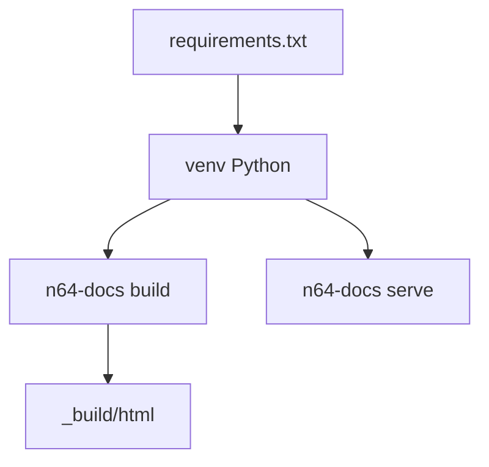

# HailToDodongo/pyrite64

> README de la documentation Sphinx de Pyrite64, sans présentation de l'outil lui-même.

## Le problème
Non documenté : le README ne décrit que la construction de la documentation, pas le problème que Pyrite64 résout.

## Ce que ça fait vraiment
Le texte fourni explique comment générer les docs avec Sphinx, à partir d'un dépôt partagé `n64-docs`. Le nom évoque la Nintendo 64, mais le README ne dit pas ce que fait le projet : à ne pas déduire.

## Comment c'est branché
Schéma simplifié d'après la fiche, sans diagramme fourni.


## Essayer
```bash
python3 -m venv .venv
source .venv/bin/activate
pip install -r requirements.txt
n64-docs build
```

## Coût et pièges
Gratuit. Il faut Python 3 pour construire les docs. Le C++ API est omis par défaut (`n64-docs serve --full` pour l'inclure).

## Ce que ce n'est pas
Pas une présentation du projet : on ne sait pas ici ce qu'il fait. Pas un outil à installer.

## Alternatives
Aucune alternative citée dans le README.

## Pour toi
Ignorer : la matière est insuffisante pour juger, et le sujet semble éloigné d'un travail data, IA ou MLOps.

