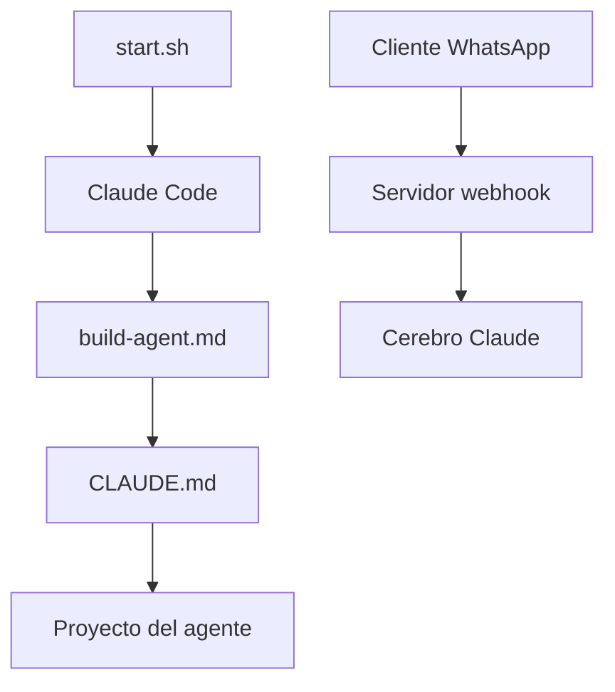

# Hainrixz/whatsapp-agentkit

> Instructions for Claude Code that generate, test and deploy a WhatsApp agent based on an interview.

## The problem
Plugging an agent into WhatsApp is mostly plumbing: webhooks, signatures, retries, deployment.

## What it actually does
- A repo of instructions (`CLAUDE.md`, `/build-agent` command), not the agent itself: the modules mentioned do not exist yet in the tree.
- Claude Code asks ten questions, then writes a FastAPI server, `brain.py`, `memory.py` and a Zernio or Meta adapter.
- The generated agent checks the HMAC signature, deduplicates events, answers 200 then processes in the background.
- Tests in a terminal chat, deployment through Docker and Railway.

## How it is wired


## Trying it
```bash
git clone https://github.com/Hainrixz/whatsapp-agentkit.git
cd whatsapp-agentkit
bash start.sh
claude
python tests/test_local.py
```
Then `/build-agent` in Claude Code.

## Cost and gotchas
Anthropic API key, a Zernio account or Meta Cloud API, Railway at 5 dollars per month. One conversation: about 0.07 dollars with Sonnet 5. Without a webhook secret, the agent accepts any message.

## What it is not
Not a ready-to-run agent. It does not perform external actions (calendar, stock, payment): `agent/tools.py` remains to be written. README in Spanish.

## Alternatives
No alternative named in the README, apart from Zernio and Meta Cloud API as providers.

## For you
Worth watching: a good example of a webhook skeleton with deduplication and signature, but the code is generated by Claude Code, so it must be reviewed before any production use.
