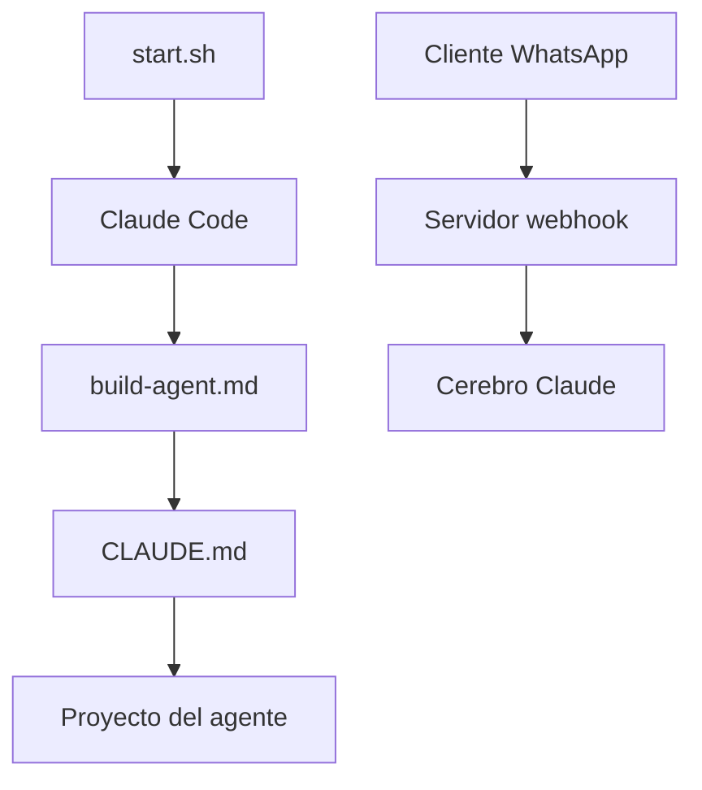

# Hainrixz/whatsapp-agentkit

> Instructions pour Claude Code qui génèrent, testent et déploient un agent WhatsApp d'après un entretien.

## Le problème
Brancher un agent sur WhatsApp, c'est surtout de la plomberie : webhooks, signatures, reprises, déploiement.

## Ce que ça fait vraiment
- Un dépôt de consignes (`CLAUDE.md`, commande `/build-agent`), pas l'agent lui-même : les modules cités n'existent pas encore dans l'arbre.
- Claude Code pose dix questions, puis écrit un serveur FastAPI, `brain.py`, `memory.py` et un adaptateur Zernio ou Meta.
- L'agent généré vérifie la signature HMAC, déduplique les événements, répond 200 puis traite en arrière-plan.
- Tests en chat terminal, déploiement par Docker et Railway.

## Comment c'est branché


## Essayer
```bash
git clone https://github.com/Hainrixz/whatsapp-agentkit.git
cd whatsapp-agentkit
bash start.sh
claude
python tests/test_local.py
```
Puis `/build-agent` dans Claude Code.

## Coût et pièges
Clé API Anthropic, compte Zernio ou Meta Cloud API, Railway à 5 dollars par mois. Conversation : environ 0,07 dollar avec Sonnet 5. Sans secret de webhook, l'agent accepte tout message.

## Ce que ce n'est pas
Pas un agent prêt à tourner. Il ne fait pas les actions externes (agenda, stock, paiement) : `agent/tools.py` reste à écrire. README en espagnol.

## Alternatives
Aucune alternative nommée dans le README, hormis Zernio et Meta Cloud API comme fournisseurs.

## Pour toi
À surveiller : bon exemple de squelette de webhook avec déduplication et signature, mais le code est généré par Claude Code, donc à relire avant toute mise en production.

