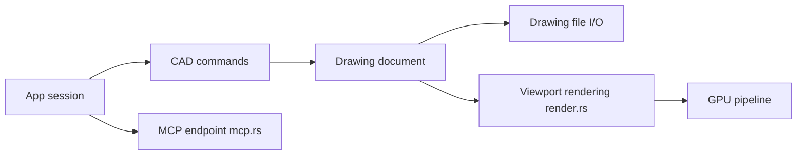

# HakanSeven12/OpenCADStudio

> Free 2D drawing and 3D modeling application written in Rust, reading and writing DWG and DXF.

## The problem
CAD software that opens DWG is paid, closed and rarely available in a browser.

## What it actually does
Editing of DWG and DXF (R14 to 2018) without a conversion service, 2D drawing (layers, blocks, xrefs, dimensions, paper space), 3D solids, `wgpu` GPU rendering. A WebAssembly web version and a desktop version. The desktop version offers command-line conversion, a JSON automation server, an MCP endpoint and plugins in separate processes.

## How it is wired


## Trying it
```bash
cargo build --release --bin OpenCADStudio
OpenCADStudio --export input.dwg output.dxf
OpenCADStudio --serve --port 4242
OpenCADStudio --mcp
```

## Cost and gotchas
Free. The README asks you to keep backups of production drawings (active development). The macOS package is not notarized.

## What it is not
Not a proven replacement for AutoCAD: a young project, STL and STEP export meshes only.

## Alternatives
No alternative named in the README.

## For you
Worth watching: the MCP endpoint for automating DWG/DXF conversions is intriguing, but the domain is far from data.
