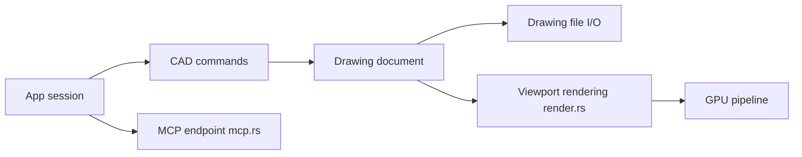

# HakanSeven12/OpenCADStudio

> Application libre de dessin 2D et modélisation 3D en Rust, lisant et écrivant DWG et DXF.

## Le problème
Les logiciels de CAO qui ouvrent le DWG sont payants, fermés et rarement disponibles dans un navigateur.

## Ce que ça fait vraiment
Édition de DWG et DXF (R14 à 2018) sans service de conversion, dessin 2D (calques, blocs, xrefs, cotes, espace papier), solides 3D, rendu GPU `wgpu`. Version web WebAssembly et version bureau. Le bureau offre conversion en ligne de commande, serveur d'automatisation JSON, endpoint MCP et greffons dans des processus séparés.

## Comment c'est branché


## Essayer
```bash
cargo build --release --bin OpenCADStudio
OpenCADStudio --export input.dwg output.dxf
OpenCADStudio --serve --port 4242
OpenCADStudio --mcp
```

## Coût et pièges
Gratuit. Le README demande de garder des sauvegardes des dessins de production (développement actif). Le paquet macOS n'est pas notarié.

## Ce que ce n'est pas
Pas un remplaçant éprouvé d'AutoCAD : projet jeune, STL et STEP exportent des maillages seulement.

## Alternatives
Aucune alternative nommée dans le README.

## Pour toi
À surveiller : l'endpoint MCP pour automatiser des conversions DWG/DXF est curieux, mais le domaine est éloigné de la data.

