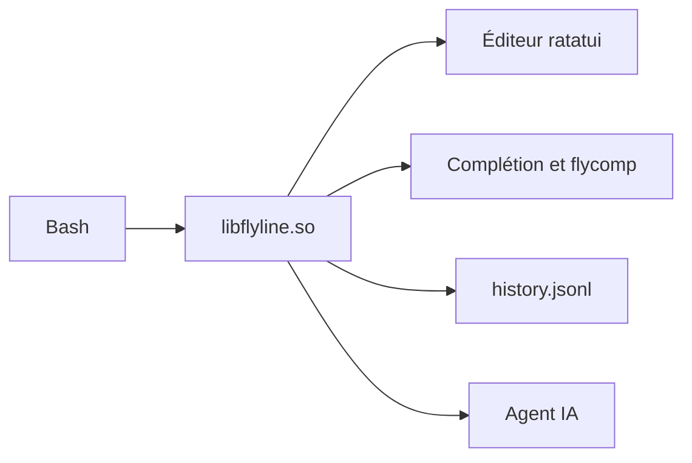

# HalFrgrd/flyline

> Rust Bash plugin that replaces readline: autosuggestions, fuzzy history, mouse, AI agent.

## The problem
Readline lacks what you expect from a modern shell: suggestions, fuzzy search, rich prompts. Stacking them through plugins makes the config fragile.

## What it actually does
Flyline loads into Bash as a builtin command (`libflyline.so`), in the same process. It adds autosuggestions, fuzzy completion, completion synthesis from `--help` (flycomp), asynchronous prompts, an animated cursor and an agent mode that turns text into a Bash command. An optional JSONL history is synchronized between sessions.

## How it is wired
Simplified diagram based on the fiche, no diagram provided.



## Trying it
```bash
source <(curl -sSfL https://github.com/HalFrgrd/flyline/releases/latest/download/install.sh)
flyline run-tutorial
```

## Cost and gotchas
Free, but the AI agent assumes you configure your own. On macOS, a recent Bash is needed (`brew install bash`). Mouse capture and some terminals require tweaks.

## What it is not
Not a new shell: it stays inside Bash. GPL-3.0 license (copyleft). The JSONL history is announced as experimental.

## Alternatives
ble.sh: same idea, written in Bash. Atuin: history only, in SQLite.

## For you
Worth watching: improves everyday comfort, but better to test it on a personal machine before imposing it on MLOps servers.
