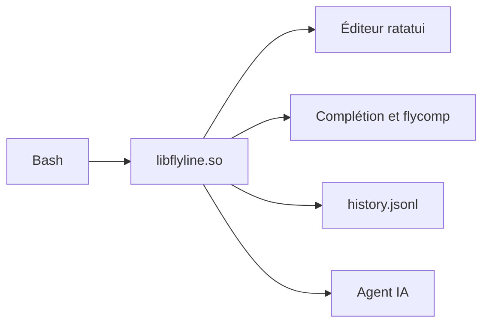

# HalFrgrd/flyline

> Plugin Bash en Rust qui remplace readline : autosuggestions, historique flou, souris, agent IA.

## Le problème
Readline manque de ce qu'on attend d'un shell moderne : suggestions, recherche floue, prompts riches. Les empiler via plugins fragilise la config.

## Ce que ça fait vraiment
Flyline se charge dans Bash comme une commande interne (`libflyline.so`), dans le même processus. Il ajoute autosuggestions, complétion floue, synthèse de complétions depuis `--help` (flycomp), prompts asynchrones, curseur animé et mode agent qui traduit du texte en commande Bash. Un historique JSONL optionnel est synchronisé entre sessions.

## Comment c'est branché
Schéma simplifié d'après la fiche, sans diagramme fourni.



## Essayer
```bash
source <(curl -sSfL https://github.com/HalFrgrd/flyline/releases/latest/download/install.sh)
flyline run-tutorial
```

## Coût et pièges
Gratuit, mais l'agent IA suppose que tu configures le tien. Sur macOS, il faut un Bash récent (`brew install bash`). La capture souris et certains terminaux demandent des réglages.

## Ce que ce n'est pas
Pas un nouveau shell : il reste dans Bash. Licence GPL-3.0 (copyleft). L'historique JSONL est annoncé expérimental.

## Alternatives
ble.sh : même idée, écrit en Bash. Atuin : historique seul, en SQLite.

## Pour toi
À surveiller : améliore le confort au quotidien, mais mieux vaut le tester sur une machine perso avant de l'imposer sur des serveurs MLOps.

