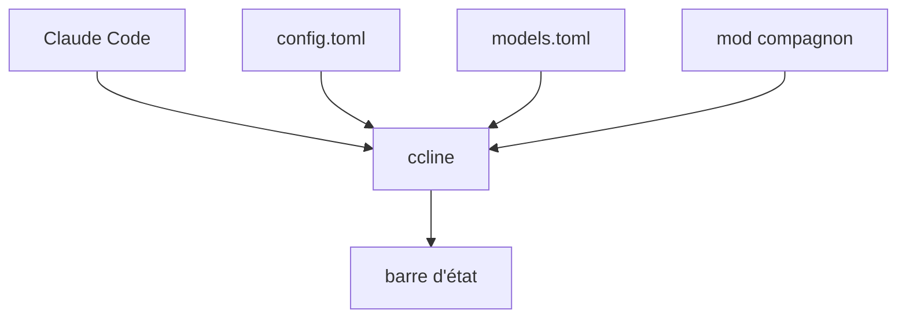

# Haleclipse/CCometixLine

> Rust status bar for Claude Code, with a full-screen configurator, for daily Claude Code users.

## The problem
Claude Code does not show at a glance the context consumed, the cache, the quota limits or the cost of the session.

## What it actually does
Displays more than 30 metrics: model, folder, git, context, cache countdown, 5-hour and weekly limits, cost. Each metric takes the form of text, a bar or a curve. Eight presets, an interactive configurator, a registry of third-party models (`models.toml`) and an optional companion mod for Claude Code 2.1.287 and above.

## How it is wired
Simplified diagram based on the sheet, no diagram provided.


## Trying it
```bash
npm install -g @cometix/ccline
ccline
ccline preview
ccline mod install
```

## Cost and gotchas
Free. A Nerd Font is recommended, otherwise use the `unicode` or `ascii` glyphs. Claude Code 2.1.153 or above required; some metrics need more recent versions.

## What it is not
Not an exact cost-tracking tool: it reads what Claude Code passes to it. v2 is a rewrite that no longer reads the v1 config. No license is declared in the catalog.

## Alternatives
- tweakcc: customizes Claude Code themes and thinking verbs (cited in the README).

## For you
Worth watching: handy if you work with Claude Code and want to track your context and quota, but the license is missing and a single author maintains it.
