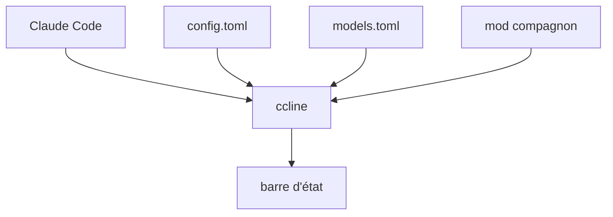

# Haleclipse/CCometixLine

> Barre d'état en Rust pour Claude Code, avec configurateur plein écran, pour utilisateurs quotidiens de Claude Code.

## Le problème
Claude Code n'affiche pas d'un coup d'œil le contexte consommé, le cache, les limites de quota ni le coût de la session.

## Ce que ça fait vraiment
Affiche plus de 30 métriques : modèle, dossier, git, contexte, compte à rebours du cache, limites 5 heures et hebdomadaire, coût. Chaque métrique prend la forme d'un texte, d'une barre ou d'une courbe. Huit préréglages, un configurateur interactif, un registre de modèles tiers (`models.toml`) et un mod compagnon facultatif pour Claude Code 2.1.287 et plus.

## Comment c'est branché
Schéma simplifié d'après la fiche, sans diagramme fourni.


## Essayer
```bash
npm install -g @cometix/ccline
ccline
ccline preview
ccline mod install
```

## Coût et pièges
Gratuit. Une police Nerd Font est conseillée, sinon utiliser les glyphes `unicode` ou `ascii`. Claude Code 2.1.153 ou plus requis ; certaines métriques exigent des versions plus récentes.

## Ce que ce n'est pas
Pas un outil de suivi de coûts exact : il lit ce que Claude Code transmet. La v2 est une réécriture qui ne lit plus la config v1. Aucune licence n'est déclarée au catalogue.

## Alternatives
- tweakcc : personnalise thèmes et verbes de réflexion de Claude Code (cité dans le README).

## Pour toi
À surveiller : pratique si tu travailles avec Claude Code et veux suivre ton contexte et ton quota, mais la licence manque et un seul auteur l'entretient.

