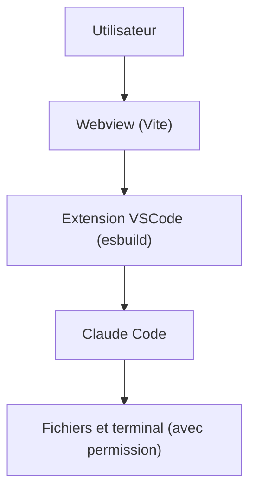

# Haleclipse/Claudix

> VSCode extension that integrates Claude Code into the editor with chat, history and tools.

## The problem
Using Claude Code from a terminal forces you to leave the editor to follow the conversation and the changes.

## What it actually does
Adds a chat sidebar for Claude Code: sessions, history, file operations, terminal commands with approval and streamed responses. The README says nothing more. The project is built with pnpm and installed from a `.vsix` file.

## How it is wired
Simplified diagram based on the sheet, no diagram provided.



## Trying it
```bash
pnpm install
pnpm build
pnpm package
# puis Extensions > Install from VSIX dans VSCode
```

## Cost and gotchas
You need Claude Code and its subscription or key, VSCode 1.98 minimum and Node 18. No version published on a marketplace is mentioned.

## What it is not
Not a standalone application nor an alternative client: the extension relies on an installed Claude Code. Short README, internal workings undocumented. AGPL-3.0 license.

## Alternatives
No alternative named in the README.

## For you
Ignore: duplicates an official VSCode integration, poorly documented, no commit since April 2026.
