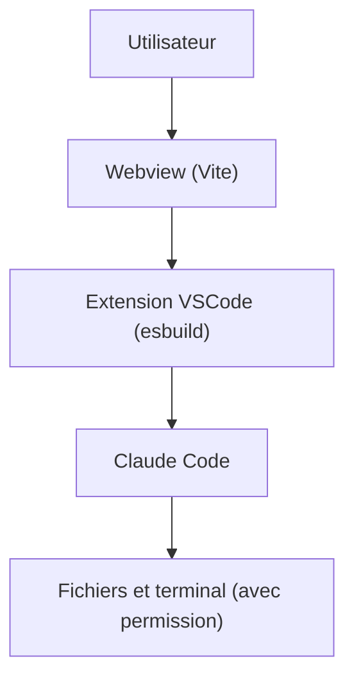

# Haleclipse/Claudix

> Extension VSCode qui intègre Claude Code dans l'éditeur avec chat, historique et outils.

## Le problème
Utiliser Claude Code depuis un terminal oblige à quitter l'éditeur pour suivre conversation et modifications.

## Ce que ça fait vraiment
Ajoute une barre latérale de chat avec Claude Code : sessions, historique, opérations sur fichiers, commandes de terminal avec approbation et réponses en flux. Le README n'en dit pas davantage. Le projet se compile avec pnpm et s'installe depuis un fichier `.vsix`.

## Comment c'est branché
Schéma simplifié d'après la fiche, sans diagramme fourni.



## Essayer
```bash
pnpm install
pnpm build
pnpm package
# puis Extensions > Install from VSIX dans VSCode
```

## Coût et pièges
Il faut Claude Code et son abonnement ou sa clé, VSCode 1.98 minimum et Node 18. Aucune version publiée sur une place de marché n'est mentionnée.

## Ce que ce n'est pas
Pas une application autonome ni un client alternatif : l'extension s'appuie sur Claude Code installé. README bref, fonctionnement interne non documenté. Licence AGPL-3.0.

## Alternatives
Aucune alternative nommée dans le README.

## Pour toi
À ignorer : doublon d'une intégration officielle pour VSCode, peu documenté, sans commit depuis avril 2026.

