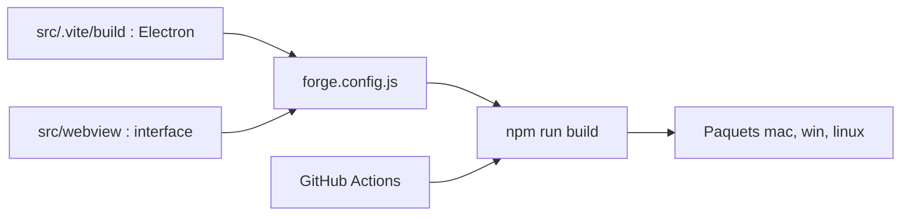

# Haleclipse/CodexDesktop-Rebuild

> Cross-platform Electron rebuild of the OpenAI Codex Desktop application, for those who want it outside macOS.

## The problem
Codex Desktop is not offered on every platform; this repository tries to rebuild it for Linux, Windows and Mac Intel/ARM.

## What it actually does
An Electron Forge project: main process in `src/.vite/build/`, interface in `src/webview/`, per-platform build scripts. GitHub Actions builds on every push to `master` and creates a draft release on a `v*` tag. The exact origin of the code (@cometix/codex binaries) is not detailed: not documented.

## How it is wired


## Trying it
```bash
npm install
npm run build
npm run build:linux-x64
npm run dev
```

## Cost and gotchas
Free. An OpenAI account is still needed to use Codex itself (not specified by the README). No license declared on the repository.

## What it is not
Not an OpenAI product: the README credits © OpenAI and Cometix Space. Without a license, nothing authorizes reuse or redistribution of the code.

## Alternatives
No alternative named in the README.

## For you
Ignore: with no license, a murky origin and a dependence on a proprietary product, it is risky; use the official Codex clients.
