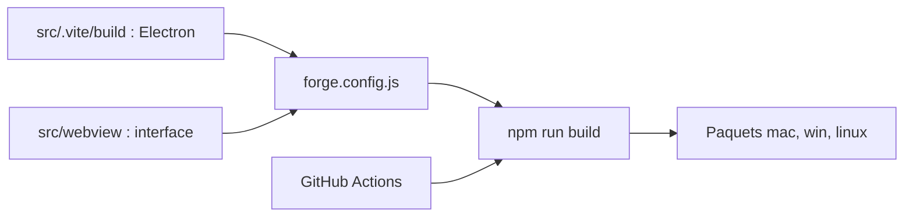

# Haleclipse/CodexDesktop-Rebuild

> Reconstruction Electron multiplateforme de l'application OpenAI Codex Desktop, pour qui la veut hors macOS.

## Le problème
Codex Desktop n'est pas proposé sur toutes les plateformes ; ce dépôt tente de le reconstruire pour Linux, Windows et Mac Intel/ARM.

## Ce que ça fait vraiment
Projet Electron Forge : processus principal dans `src/.vite/build/`, interface dans `src/webview/`, scripts de build par plateforme. GitHub Actions compile à chaque push sur `master` et crée une version brouillon sur tag `v*`. L'origine exacte du code (binaires @cometix/codex) n'est pas détaillée : non documenté.

## Comment c'est branché


## Essayer
```bash
npm install
npm run build
npm run build:linux-x64
npm run dev
```

## Coût et pièges
Gratuit. Un compte OpenAI reste nécessaire pour utiliser Codex lui-même (non précisé par le README). Aucune licence déclarée sur le dépôt.

## Ce que ce n'est pas
Pas un produit OpenAI : le README crédite © OpenAI et Cometix Space. Sans licence, rien n'autorise la réutilisation ou la redistribution du code.

## Alternatives
Aucune alternative nommée dans le README.

## Pour toi
À ignorer : sans licence, d'origine floue et dépendant d'un produit propriétaire, il est risqué ; utilise les clients officiels de Codex.

