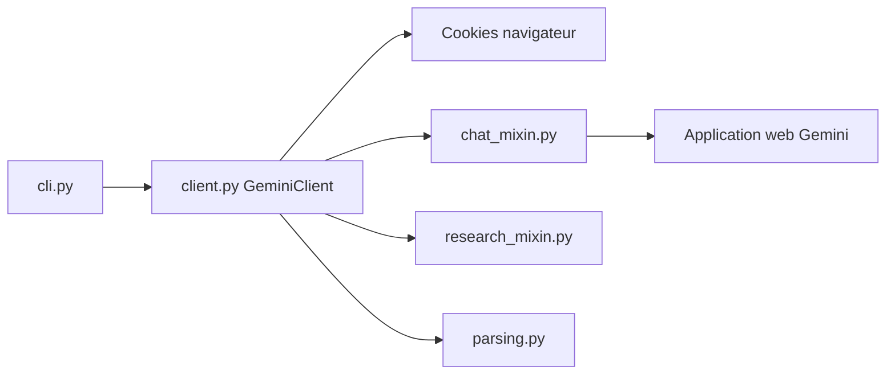

# HanaokaYuzu/Gemini-API

> Reverse-engineered asynchronous Python wrapper that drives the Gemini web app with your Google account.

## The problem
Using the Gemini app's features (Gems, extensions, Deep Research, image and video generation) without going through the official API.

## What it actually does
`GeminiClient` authenticates with the `__Secure-1PSID` and `__Secure-1PSIDTS` cookies, refreshes them in the background, then sends prompts and files. It handles conversations, history, Gems, extensions (Gmail, YouTube), streaming, generated images, videos and audio, and Deep Research (plan, confirmation, polling, report). A CLI (`cli.py`) exists. Available models are discovered dynamically per account.

## How it is wired


## Trying it
```bash
pip install -U gemini_webapi
pip install -U gemini_webapi[browser]
python cli.py --cookies-json cookies.json ask "What is quantum computing?"
```

## Cost and gotchas
You must extract session cookies from your browser; on Chromium they may be valid for only a few hours, Firefox is recommended. Python 3.11+. Video, audio and Deep Research sometimes require a subscription.

## What it is not
Not the official API: it can break with any change on Google's side and touches your personal account. AGPL-3.0 licence, with the publication obligations that come with it.

## Alternatives
The README cites Google AI Studio (the official API) and acheong08/Bard, from which it derives.

## For you
Worth watching for personal scripts, never for a service: dependence on cookies, AGPL, a single maintainer; prefer the official API.
