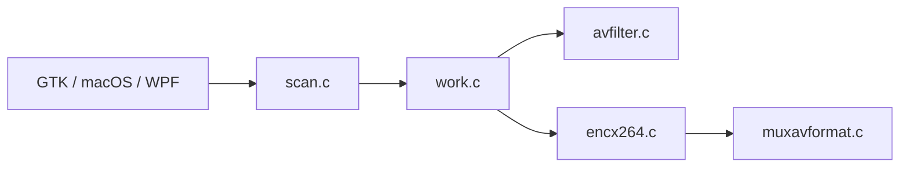

# HandBrake/HandBrake

> Open-source video transcoder (Linux, Mac, Windows) to convert your videos to MP4, MKV or WebM.

## The problem
Adapting videos (cameras, captures, DVDs, Blu-rays) to formats playable on a phone, TV or browser.

## What it actually does
Shared `libhb` engine (scan, filters, encoding via FFmpeg, x264, x265, SVT-AV1 and hardware encoders, mux) with three interfaces: GTK, macOS (with an XPC service) and Windows WPF (with an HTTP worker). Built-in presets. Dependencies are built from `contrib/`.

## How it is wired

## Trying it
No command documented in the README; it points to the official documentation.

## Cost and gotchas
Free. License present but not identified by GitHub; the README cites GPL v2. Hardware encoders depend on the GPU.

## What it is not
Not a video editor; it transcodes existing files.

## Alternatives
No alternative named in the README.

## For you
Useful for preparing video datasets (changing codec or reducing size); otherwise off topic.
