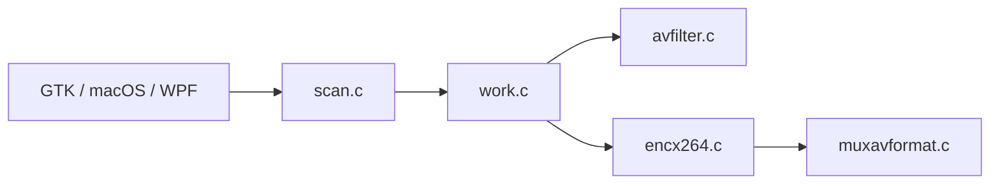

# HandBrake/HandBrake

> Transcodeur vidéo open source (Linux, Mac, Windows) pour convertir ses vidéos en MP4, MKV ou WebM.

## Le problème
Adapter des vidéos (caméras, captures, DVD, Blu-ray) aux formats lisibles par téléphone, TV ou navigateur.

## Ce que ça fait vraiment
Moteur partagé `libhb` (scan, filtres, encodage via FFmpeg, x264, x265, SVT-AV1 et encodeurs matériels, mux) avec trois interfaces : GTK, macOS (avec service XPC) et Windows WPF (avec worker HTTP). Presets intégrés. Les dépendances sont compilées depuis `contrib/`.

## Comment c'est branché

## Essayer
Aucune commande documentée dans le README ; il renvoie à la documentation officielle.

## Coût et pièges
Gratuit. Licence présente mais non identifiée par GitHub ; le README cite la GPL v2. Les encodeurs matériels dépendent du GPU.

## Ce que ce n'est pas
Pas un éditeur vidéo ; il transcode des fichiers existants.

## Alternatives
Aucune alternative nommée dans le README.

## Pour toi
Utile pour préparer des jeux de données vidéo (changer de codec ou réduire la taille) ; sinon hors sujet.

